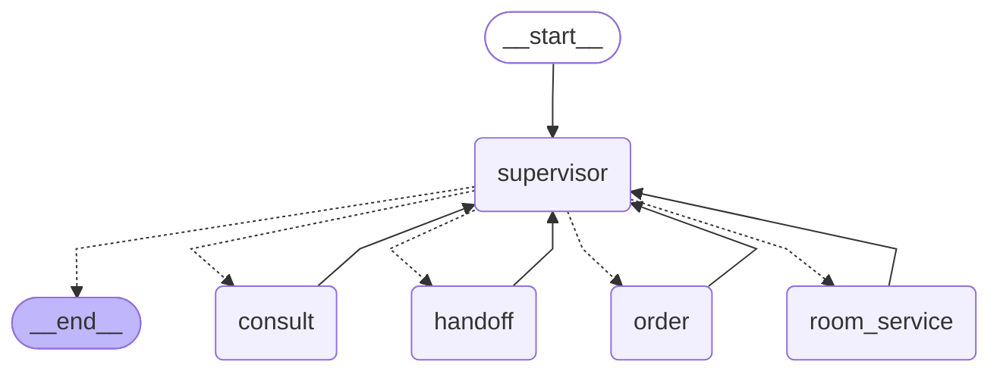

# 多智能体运行时拓扑（supervisor + 4 子 Agent）

本文件的多层图**由编译后的 LangGraph 图直接渲染**（不是手绘），因此不会与代码漂移；
`tests/test_supervisor_graph_shape.py` 会重新渲染并逐节点、逐边比对本文件的 mermaid，
不一致即失败——改图后按下方命令重新生成。

## 拓扑图



实线是普通边，虚线是 `Command(goto=...)` 的派发去向（`supervisor` 节点用 `destinations=`
显式声明，否则这些边在静态图里不可见、子图节点会成孤立点）。

## 节点职责

| 节点 | 载体 | 职责 |
| --- | --- | --- |
| `supervisor` | `supervisor/graph.py` | 决策派发目标；超过派发上限或无可派发目标时转 `__end__` |
| `consult` | `buildin/front_desk_consult` | 知识问答、房型、时间；默认落点 |
| `order` | `buildin/front_desk_order` | 预订、改期、续订、取消、发票 |
| `room_service` | `buildin/room_service` | 清洁、送物、机器人配送 |
| `handoff` | `buildin/handoff` | 投诉/退款/赔偿 → 生成待处理工单 |

## 派发语义

- 一次 Run 内可多次派发（复合请求逐个派发），派发痕迹由装配期闭包持有，不随检查点跨 Run
  残留；上限见 `routing.MAX_DISPATCHES`。
- 决策以 LLM 结构化输出为主，失败或不可用时落关键词兜底（`routing.SupervisorRouter`）。
- 授权感知：决策目标在当前资源快照下无可见工具、而其他子 Agent 有工具时，改派后者。
- 事实留痕：每次决策先落 `route_audit`（判定值 / 判定来源 llm|keyword / 实际派发目标，收尾时
  派发目标为 NULL），归属 `agent_slug='supervisor'`；决策若调用真实模型（结构化输出），该模型
  事实同样归到 supervisor 并计入 Run 用量（`on_usage` 旁路累计），路由提示词不经流水线
  （不注入记忆 / 技能 / steer）。
- 事件归属：子图内发射的事件 `agent_slug` 归到具体子 Agent，`entry_slug` 恒为 Run 入口 Agent。
- 对外契约不变：图入口仍是 `AgentRunBody` 按 slug 取编译图，`chat_router` / SSE / Run 执行器无感。

## 重新生成

```bash
cd backend
python - <<'PY'
import asyncio
from uuid import uuid4
from app.agents.context import ResourceSnapshot
from app.agents.models import DevStubChatModel
from app.agents.runtime import RuntimeContext
from app.agents.supervisor.assembly import build_agent_pipeline
from app.agents.supervisor.graph import build_supervisor_graph
from app.db import SessionFactory
from app.services.audit_service import AuditRecorder

async def main() -> None:
    runtime = RuntimeContext(
        agent_slug="front-desk", user_id=uuid4(), thread_id=uuid4(), run_id=uuid4(),
        actor_id="topology", resources=ResourceSnapshot(), config={}, prompt_docs="",
        checkpointer=None,
        recorder=AuditRecorder(run_id=uuid4(), agent_slug="front-desk", session_factory=SessionFactory),
    )
    graph = await build_supervisor_graph(
        runtime, model=DevStubChatModel(), pipeline=build_agent_pipeline(runtime)
    )
    print(graph.get_graph().draw_mermaid())

asyncio.run(main())
PY
```