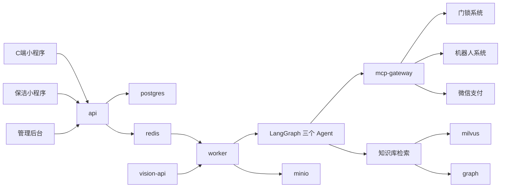
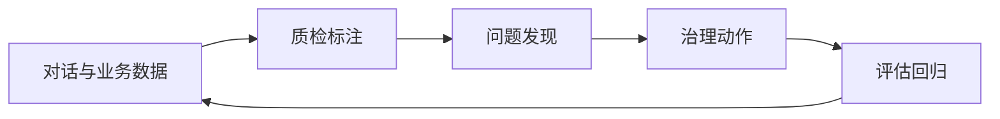

# HaoChen 无人酒店 Agent 核心服务端设计

状态：accepted（P0.1 评审通过，2026-09-27）。配套决策记录持有替代方案、验收标准与风险：[HaoChen 无人酒店 Agent 核心服务端架构选型](./2026-09-27-hotel-agent-server-design.md)。

预定读者是 HaoChen 项目的开发者与评审者。本文档定义无人酒店三端的 Agent 核心服务端边界、领域模型、关键链路、运行可视化和数据中心设计。小程序页面视觉、门锁与机器人硬件协议细节、酒店线下运营流程由对应实现仓库的代码与文档承接，不在本文档范围内。

## 三端能力与 Agent 分工

| 端 | 载体 | 核心能力 |
| --- | --- | --- |
| C 端客户 | 微信小程序 | 酒店咨询、房型查询、预订、改期、取消、发票申请、客房需求（购买物品、清洁）、退房、投诉、周边推荐 |
| 员工端（保洁） | 微信小程序 | 接收清洁派单、退房改密与留证、打卡审核、呼叫清洁处理 |
| 管理后台 | Web | Agent 配置与管理、会话监控与质检、风险告警、数据报表、智能体日志、酒店基础数据、记忆管理 |

三个内置 Agent 共用同一套运行时与存储：front-desk（前台接待）面向 C 端客人，持有咨询、房型、订单、客房服务、门锁凭证、退房与投诉类工具；housekeeping-assistant（员工助手）面向保洁员工，持有派单接收、清洁流程、改密确认与打卡辅助类工具；qa-auditor（质检员）离线运行，消费对话与审计数据，产出质检标签、风险告警与数据质量检查结果。

## 总体架构

后端技术组合：FastAPI 提供 `/api` 接入，LangGraph 装配 Agent 图，ARQ worker 执行 AgentRun 与 Durable Task，PostgreSQL、Redis、MinIO、Milvus、Neo4j 承担存储分工，Docker Compose 定义运行拓扑。小程序端以 uni-app（Vue 3）编译到微信小程序，管理后台使用 Vue 3 + Vite + Ant Design。

| 服务 | 职责 |
| --- | --- |
| api | 三端 HTTP 接入、认证、SSE 推送 |
| worker | AgentRun 执行；Durable Task 运行密码轮换、清洁任务收敛、质检跑批 |
| web | 管理后台前端 |
| mcp-gateway | 门锁、机器人、微信支付与 PMS 的 MCP 服务器 |
| vision-api | 打卡视觉审核：人脸 1:1 比对、工牌 OCR、工服检测 |
| postgres | 业务事实、请求与 Run、审计、LangGraph checkpoint |
| redis | ARQ 投递、运行事件、取消信号与短期缓存 |
| minio | 知识库原件、打卡照片与清洁留证 |
| milvus | 知识库向量与 BM25 字段 |
| graph | 房型、设施与周边关系图 |

存储分工遵循每个存储只拥有自己事实的原则，与[知识库存储分工](./mechanism-baseline.md#28-知识库)一致：PostgreSQL 拥有订单、房间、凭证哈希、任务、Run、审计与 checkpoint；Redis 承担投递与事件，不拥有最终业务状态；MinIO 拥有对象字节；Milvus 拥有向量坐标；Neo4j 拥有关系图。跨存储写按各自提交边界执行，失败显式标记并可从两侧查证。

## 酒店领域模型

状态机取值、字段名与指标口径的冻结定义见 [领域术语表](./glossary.md)（P0.1 冻结），本节与实现均以该表为准。

| 实体 | 拥有的事实 |
| --- | --- |
| room_types、rooms | 房型、房价、房间档案、门锁设备号 |
| lock_credentials | 房间密码哈希、生效窗口、轮换状态与来源 |
| orders | 预订、改期、取消、续订、支付状态、入住与退房时间 |
| housekeeping_tasks | 清洁派单：退房清洁与呼叫清洁、执行状态、留证 |
| robot_deliveries | 物品购买配送任务与状态 |
| attendance_checkins | 打卡记录与 AI 审核结果 |
| invoices、complaints | 发票申请与投诉处理记录 |
| guests、staff | 客人（微信身份）与员工账号 |
| guest_memories | 客人偏好记忆与敏感标记 |

订单状态机：created → pending_payment → paid → checked_in → checkout_pending → completed；改期与续订以事件记录挂在订单上（rescheduled、extended），取消产生 cancelled 终态。支付回调先提交 PostgreSQL 事实，再投递 worker 触发密码下发与入住指引。

清洁任务状态机：pending → accepted → in_progress → done → verified → closed。退房清洁在 verified 步骤要求保洁确认已完成密码修改；超时未确认进入 escalated 并由店长告警，任务不进入 closed。

房间密码生命周期：每日轮换生成次日凭证（next → active），当日凭证到期作废；客人续订保持当前凭证有效；退房清洁确认改密后旧凭证立即吊销（revoked）。数据库中只保存 code_hash 与生效窗口，明文只存在于门锁设备与下发时刻的临时载荷。

## Agent 运行时设计

Agent 图沿用 LangGraph 中间件流水线（见[中间件装配差分](./mechanism-baseline.md#3-中间件装配差分)），复用 TokenUsageMiddleware、ModelRetryMiddleware、PatchToolCallsMiddleware、memory、summary、tool approval、Skills、Steer、filesystem 九个工位，并新增两个：

| 新增中间件 | 职责 |
| --- | --- |
| CredentialGuard | 对工具回包与助手消息中的密码字段打码入库；阻止密码进入长期记忆与知识库；约束模型不主动复述历史密码 |
| ToolGuard | 为订单与门锁类副作用工具注入幂等键；拦截重复下单、重复改密调用 |

工具注册与授权分离（见[工具系统](./mechanism-baseline.md#25-工具系统注册与授权分离)）：工具在 Graph 装配时注册，在执行处以当前客人、房间、订单权限 fail-closed 复验。工具分组：

| 分组 | 工具 | 说明 |
| --- | --- | --- |
| 咨询 | query_kb、list_kbs | 酒店介绍、政策、FAQ 检索 |
| 房型 | search_room_types、check_availability | 房型、价格、房态查询 |
| 订单 | create_order、reschedule_order、cancel_order、renew_order、apply_invoice | 副作用工具，幂等且执行处复验 |
| 客房 | request_room_service | buy 分支呼叫机器人配送，clean 分支创建保洁派单 |
| 门锁 | get_checkin_credential、rotate_room_credential | 经 lock-mcp 调用，Agent 不持有密码存储 |
| 退房与投诉 | initiate_checkout、submit_complaint、recommend_nearby | 退房触发清洁与改密流程 |

Skills 按渐进加载管理（见 [Skills 机制](./mechanism-baseline.md#26-skills)）：checkin-flow（支付校验、密码下发、入住指引）、checkout-flow（退房、清洁、发票）、housekeeping（保洁流程与留证规范，员工 Agent 专用）、complaint-handling（投诉分级与告警）、invoice（发票流程）。

MCP 服务器经管理后台启用与配置（见 [MCP 与网关](./mechanism-baseline.md#27-mcp-与-mcp-gateway)）：lock-mcp（凭证生成、轮换、开锁记录）、robot-mcp（配送下单与状态）、wechat-mcp（登录与支付回调状态）、pms-mcp（可选，房态同步）。

## 关键链路

### 咨询与房型查询

知识库上传走管理链路（解析、分块、索引）由 Durable Task 完成；咨询走只读借书链路，检索沿用两段式架构：召回阶段宽捞候选，重排阶段精排后交给模型，细节见[知识库机制](./mechanism-baseline.md#28-知识库)。酒店政策类问题的评估口径见下文的双评估体系。

### 预订到入住

客人提出预订后，front-desk 创建待支付订单并给出支付入口；支付回调确认后订单进入 paid，worker 触发 checkin-flow：从 lock_credentials 取当前有效凭证，经 CredentialGuard 处理后在会话与微信服务通知中下发密码、楼层房号与入住指引（WiFi、早餐、退房时间来自知识库）。密码下发的审计记录保留凭证版本，不保留明文。

### 客房需求分派

客人发起客房需求时，request_room_service 按类型分流：购买物品创建 robot_deliveries 并经 robot-mcp 呼叫机器人配送；呼叫清洁创建 housekeeping_tasks（on_demand_clean）并推送保洁小程序。呼叫清洁完成后由客人评分评价，保洁端不提交清洁说明与照片。

### 退房与改密

客人发起退房或到达退房时间后，housekeeping_tasks（checkout_clean）派单给保洁，任务载荷包含当前密码与目标新密码。保洁完成清洁后上传照片或视频留证、填写清洁说明并确认密码已修改；lock-mcp 完成轮换后任务进入 verified 与 closed，旧密码立即作废。超时未确认的任务进入 escalated，由店长在管理后台人工处置。

### 密码轮换规则

| 场景 | 行为 |
| --- | --- |
| 每日轮换 | worker 按调度生成次日凭证并推送到门锁设备，当日凭证到期作废 |
| 续订 | 客人续订时保持当前凭证有效，不触发轮换 |
| 退房 | 保洁确认改密后立即轮换，旧密码即时吊销 |
| 泄露处置 | 店长可在管理后台手动吊销凭证并触发一次轮换 |

### 保洁打卡审核

保洁上班与下班打卡时上传照片，vision-api 执行人脸 1:1 比对、工牌 OCR 校验与工服检测，结果（face_score、badge_ok、uniform_ok）写入 attendance_checkins。审核通过记录打卡成功；未通过进入人工复核队列并通知店长，不提供静默通过的路径。

## 运行时事实与安全边界

请求接入与执行分离遵循以下架构不变量：普通请求先在 PostgreSQL 中持久化消息与请求记录，再按客人、Agent、线程的 FIFO 顺序派发；只有队头的 ready 请求创建 AgentRun，ARQ 投递发生在数据库提交之后。运行中的 Run 由唯一 lease 拥有，heartbeat 续租，失联以可观察终态收敛。运行链路细节见[机制基线与取舍](./mechanism-baseline.md#21-分层边界与请求接入)。

授权在 FastAPI 依赖与 repository 的可见性查询处最终执行；小程序页面、管理后台守卫与提示词只影响体验，不构成授权边界。客人与房间数据按本人与本人订单范围可见，保洁只能读取派发给自己的任务载荷，管理端操作按角色与操作日志留痕。P2 落地的基座形态：登录签发不透明会话令牌（Redis 存储、滑动过期、逐请求复核账号状态），角色守卫在路由依赖，资源归属在 services/repositories 判定；拒绝语义分层为未认证/凭证失效 401、已认证但无权限或非归属 403、不可见资源 404（不区分「不存在」，避免目录探测）。负向取证见 [P2 越权负向取证记录](./drills/p2-authz-drill.md)。

房间密码的附加约束：明文不落数据库、不进入消息历史、记忆与知识库；审计与日志导出对密码字段打码；对话回复只在下发与提醒场景包含当日密码。打码在持久化边界上执行（CredentialGuard，P4.4）：工具回包进检查点与后续模型请求之前、助手消息入库之前、压缩历史落盘之前、工具入参进审计与事件投影之前一律打码；生成中的流式增量不审查——下发与提醒场景的实时回复可以带当日密码，但同一内容的落库副本必定是打码形态。客人自己输入的消息在接入侧落库，不经过该工位。

## 运行可视化

观测体系分三层，PostgreSQL 的本地审计是唯一权威事实：运行层把每次模型调用与工具调用写入 model_audit 与 tool_audit（来源键、顺序、状态、耗时、用量与错误）；外部观测层将 Run、线程与客人映射到 Langfuse trace 作为可选排障视图（见 [Langfuse 机制](./mechanism-baseline.md#211-langfuse)）；运营层在管理后台以审计事实派生报表与运行健康面板。

| 报表指标 | 计算口径 |
| --- | --- |
| 接待量 | 日/周/月的会话数、Run 数、消息数 |
| 解决率 | 一次解决（未转人工且终态 completed 且无后续同类问题）与任务成功率（订单成功数 ÷ 创建数） |
| 转人工率 | 转人工事件数 ÷ 会话数 |
| 热门问题 | 意图抽取后聚类统计的 TOP 问题 |
| 召回率 | 离线评估集 recall@k；线上统计检索片段被最终回答引用的比例 |
| token 消耗 | 按 Agent、模型、日期聚合 model_audit 的用量 |
| 缓存命中率 | 模型提示词缓存（Provider prompt caching）命中的 prompt tokens ÷ 总 prompt tokens，按 Agent、模型与日期聚合；用于评估延迟与成本节省 |
| 风险告警 | 投诉关键词、负面情绪与差评预警实时推送店长 |

运行健康面板展示 Run 终态分布、首 token 延迟、工具成功率、interrupt 比例、模型重试次数与模型提示词缓存命中率，作为业务结果之外的运行质量信号。

双评估体系包含两类评估：知识库评估在 FAQ 评估集上计算 recall@k、precision@k 与 answer_correctness；智能体评估以 Langfuse Dataset 驱动端到端任务实验，验证订单、派单等工具链结果。两类评估的机制与不变量见[机制基线与取舍](./mechanism-baseline.md#213-双评估体系)。C 端点赞点踩与保洁评分作为在线反馈与评估集一起进入数据中心。

## 数据中心与数据质量

数据中心以 PostgreSQL 为主事实，目标是让数据质量可度量、可治理：

qa-auditor 对对话打标签（解决、未解决、转人工、投诉风险、幻觉嫌疑），管理后台提供人工标注工作台复核，标注结果成为评估的黄金数据。数据质量评分卡按维度量化并驱动治理动作：

| 维度 | 指标 | 治理动作 |
| --- | --- | --- |
| 覆盖率 | 未答问题聚类后的知识缺口数 | 生成 FAQ 草稿，店长审核入库 |
| 新鲜度 | 政策与价格文档的过期检测 | 标记待更新，过期内容降权 |
| 正确性 | 幻觉嫌疑标注与业务校验失败数 | 溯源知识块，修正或下线 |
| 一致性 | 同一问题的冲突答案聚类 | 合并冲突条目 |
| 召回质量 | 低于基线的 recall@k 知识块 | 调整分块或嵌入配置后重评 |

知识库内容、提示词或工具权限变更后，旧评估分数作废并开新实验，回归结果作为发布依据。客人记忆保存偏好（房型、楼层、枕头类型），身份证、手机号、支付信息与密码标记为敏感，默认不进入长期记忆与知识库，删除时级联清理向量副本。

## 平台机制与酒店场景的对应关系

| 平台机制 | 酒店场景用法 |
| --- | --- |
| 薄路由、services 用例、repositories 持久化 | 订单、派单、凭证用例的分层落地 |
| Request/Run 两阶段与线程 FIFO | 客人与员工请求接入、支付回调触发 |
| LangGraph 中间件流水线 | front-desk 与 housekeeping-assistant 的图装配 |
| 五套存储分工 | 业务事实、对象、向量、图与缓存的边界 |
| 两段式检索 | 酒店政策与 FAQ 的咨询检索 |
| 双评估体系 | 知识库评估与端到端任务实验 |
| Langfuse 与本地双审计 | 运行可视化的排障视图与事实层 |
| Durable Task | 密码轮换、清洁超时收敛、质检跑批 |

## 验证

本方案状态的验收主张、证据矩阵与负向案例由配套决策记录拥有。截至 P2，领域模型与授权基座已落地并完成 A6 取证（见 [P2 越权负向取证记录](./drills/p2-authz-drill.md)）；其余主张在对应阶段交付前，本文档不声明任何已验证结果。
