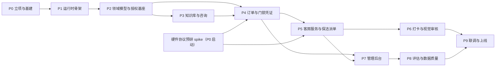

# HaoChen 智能酒店 Agent 项目开发流程

状态：draft
日期：2026-09-27
上游输入：[design.md](./design.md)（核心服务端设计 Owner）、[2026-09-27-hotel-agent-server-design.md](./2026-09-27-hotel-agent-server-design.md)（架构选型决策）

本文档定义 HaoChen 无人酒店 Agent 项目从零到上线的阶段划分、每阶段具体工作内容、交付物、退出标准与验收方式。小程序页面视觉、门锁与机器人硬件协议细节、酒店线下运营流程由对应实现仓库的代码与文档承接，不在本文档范围内。

## 1. 开发策略

### 1.1 三条并行主线

| 主线 | 内容 | 覆盖阶段 |
| --- | --- | --- |
| 平台主线 | 运行时骨架（Request/Run、线程 FIFO、租约）、三端接入、审计与 SSE、管理后台 | P0–P2、P7 |
| 酒店业务主线 | 订单状态机、门锁凭证生命周期、清洁派单、机器人配送、打卡审核 | P4–P6 |
| 数据与质量主线 | 知识库检索、双评估体系、质检标注、报表与数据质量治理 | P3、P8 |

### 1.2 五条工程原则

1. **Mock 先行**：门锁、机器人、微信支付、视觉审核先以契约 mock 实现，全部业务在 mock 上闭环；真实设备联调独立成为 P9 工作包，无法对接时保留人工前台兜底通道。
2. **事实先落库**：外部事件（支付回调、机器人状态）先提交 PostgreSQL 事实，再投递 worker；队列消息永不先于数据库状态。
3. **授权在服务端**：FastAPI 依赖 + repository 可见性查询是唯一授权边界；前端守卫与提示词只影响体验，不构成授权。
4. **密码零明文**：明文不落数据库、不进消息历史/记忆/知识库；审计与导出对密码字段打码。以自动化扫描测试守住该不变量。
5. **验收矩阵驱动**：决策记录的 6 条验收主张是 P4 起每个阶段出口的硬门槛，逐条以直接证据取证并回填决策记录。

### 1.3 阶段地图



### 1.4 里程碑总表

| 里程碑 | 阶段 | 建议周次 | 出口证据（Gate） |
| --- | --- | --- | --- |
| M0 基建就绪 | P0 | W1–W2 | compose 全服务 healthy；CI 全绿；外部接口契约 v0 评审通过 |
| M1 运行时闭环 | P1 | W3–W5 | 消息→Run→模型→SSE 全链路；杀 worker 状态收敛；审计行完整 |
| M2 领域与授权基座 | P2 | W5–W7 | 状态机测试与越权负向测试全绿（验收主张 6 取证） |
| M3 咨询可用 | P3 | W7–W9 | 带引用问答上线；知识库评估基线落库 |
| M4 入住闭环 | P4 | W8–W12 | 支付后下发密码与入住指引；明文扫描通过；重复回调幂等（验收主张 1/2/3） |
| M5 服务与派单闭环 | P5 | W11–W14 | 购买→机器人配送；清洁→派单→改密→封闭环；超时升级可见 |
| M6 打卡闭环 | P6 | W13–W15 | 打卡审核与人工复核队列可用，无静默通过路径 |
| M7 管理后台可用 | P7 | W12–W17 | 报表与审计重算一致（验收主张 4）；告警、转人工、日志闭环 |
| M8 评估闭环 | P8 | W16–W18 | 新旧评估分数可比较；内容变更旧基线作废（验收主张 5） |
| M9 上线 | P9 | W18–W22 | 6 条验收主张全部取证；单店试点稳定运行 |

总周期约 22 周（5～6 个月），按 6～8 人团队并行度估算。排期以 Gate 通过为准，不按日期硬推。

### 1.5 迭代节奏

- 双周一个迭代，每周一次内部 demo（可运行演示，不接受 PPT-only）。
- 阶段末 Gate 评审：演示 + 证据回放 + 测试报告，通过后才进入下一阶段；未通过则回到阶段内修复。
- 每迭代刷新一次评估与报表数据，作为质量趋势基线。

## 2. 全局工程约定（贯穿所有阶段）

### 2.1 仓库布局（monorepo 建议）

```
haochen/
├── docs/                     # 本文档、设计文档、决策记录、外部契约
├── backend/
│   ├── app/
│   │   ├── routers/          # FastAPI：薄路由 + 依赖注入 + SSE
│   │   ├── services/         # 用例层：订单、派单、凭证、打卡、报表、运行时
│   │   ├── repositories/     # 持久化层：可见性查询、幂等键
│   │   ├── models/           # SQLAlchemy 模型（业务表、审计表）
│   │   ├── agents/           # LangGraph 图装配、中间件、tools、skills、prompts
│   │   ├── worker/           # ARQ：AgentRun 执行 + Durable Task（轮换/收敛/跑批）
│   │   ├── device_sim/       # 契约 mock：门锁/机器人/微信，含故障注入
│   │   ├── mcp_gateway/      # lock-mcp、robot-mcp、wechat-mcp、pms-mcp
│   │   ├── vision_api/       # 人脸 1:1、工牌 OCR、工服检测
│   │   └── knowledge/        # 知识库 manager 与 Milvus 实现
│   ├── migrations/           # Alembic
│   ├── tests/                # unit / integration / e2e / security / eval
│   └── pyproject.toml
├── apps/
│   ├── guest-miniapp/        # uni-app（Vue 3）C 端
│   ├── staff-miniapp/        # uni-app（Vue 3）保洁端
│   └── admin-web/            # Vue 3 + Vite + Ant Design
├── deploy/                   # docker-compose、环境模板
└── .github/workflows/        # CI
```

### 2.2 环境与配置

| 环境 | 硬件 | 支付 | 用途 |
| --- | --- | --- | --- |
| local | 契约 mock（含故障注入开关） | 沙箱 | 日常开发与单测/集成测试 |
| staging | 沙箱或真机备用房间 | 沙箱 | 联调、E2E、评估回归 |
| pilot | 单店 1–2 房间真机 | 生产 | 试点灰度 |
| prod | 全店真机 | 生产 | 正式运营 |

密钥与门锁主密钥只经环境变量/密钥管理下发，绝不入库入仓；`.env.example` 只含占位符。

### 2.3 CI 门禁（PR 必须全绿）

- 后端：ruff + mypy + pytest（unit/integration，集成测试连真实 PostgreSQL 与 Redis）
- 前端：eslint + vue-tsc + vitest；三端各自构建产物检查
- 迁移：Alembic upgrade/downgrade 双向校验
- 安全：密钥扫描 + **密码明文扫描测试**（扫订单、消息、记忆、审计、导出物）
- 提交规范：conventional commits；PR 模板含"关联验收主张"栏

### 2.4 测试策略与 DoD

| 层级 | 范围 | 硬性要求 |
| --- | --- | --- |
| 单元 | 状态机、幂等、授权判定、打码函数 | 非法状态迁移必须被拒绝 |
| 集成 | 请求接入、投递顺序、租约恢复、幂等回调 | 连真实 PG/Redis，禁 mock 数据库 |
| E2E | 支付→密码→入住；清洁→派单→改密；打卡审核 | 与 mock 门锁/机器人全链路，含故障注入 |
| 安全 | 越权矩阵、明文扫描、打码检查 | 负向用例必须返回拒绝且数据不变 |
| 评估 | 知识库 recall@k/precision@k/正确性；端到端任务实验 | 变更后旧基线作废并开新实验 |

Definition of Done（每个功能）：代码 + 测试 + 迁移 + 审计埋点 + 观测指标可见 + 文档同步。

## 3. 阶段详细内容

### P0 立项、决策收口与基建（W1–W2）

**目标**：把 proposed 决策落为可执行的工程底座，消除硬件协议的不确定性。

| # | 任务 | 具体内容 | 交付物 |
| --- | --- | --- | --- |
| 0.1 | 决策与设计收口 | 评审 design.md 与决策记录，状态 proposed→accepted；冻结领域词汇表（订单/凭证/派单状态机定义） | accepted 决策记录、术语表 |
| 0.2 | 外部系统协议预研（关键路径） | 门锁 SDK/协议（凭证下发、轮换、吊销、开锁记录）、机器人配送接口、微信支付回调签名、PMS 可选；逐项验证真实协议、回调签名与失败语义（未验证项登记在契约 §7） | 《外部系统接口契约 v0》[docs/contracts/](./contracts/external-systems-v0.md) + 失败语义表 + 无法对接项清单与人工兜底方案 |
| 0.3 | Mock 服务 | lock-mcp / robot-mcp / wechat-mcp 契约 mock，支持故障注入（超时、业务失败、断连、重复回调） | deploy/mock + 注入开关 |
| 0.4 | 基础设施 | docker compose：api、worker、web、postgres、redis、minio、milvus、neo4j + healthcheck + 一键启动脚本 | deploy/ + 启动文档 |
| 0.5 | 后端骨架 | FastAPI 薄路由 + services + repositories 三层目录；配置加载、结构化日志、异常映射 | backend/ 骨架 |
| 0.6 | 迁移与审计基线 | Alembic 初始化；model_audit、tool_audit 表；LangGraph checkpoint 表方案 | 首个迁移 + 审计表迁移 |
| 0.7 | 三端脚手架 | 两个 uni-app 工程（登录、路由、请求层、鉴权拦截）；admin-web（布局、登录、RBAC 菜单骨架） | 三端空壳可登录 |
| 0.8 | CI 与协作 | lint/type/test/migration/secret-scan 流水线；PR 模板；分支保护 | workflows + 分支规则 |

**退出标准**：compose 起全部服务 healthy；CI 在 PR 上全绿；接口契约 v0 评审通过并登记未验证项；硬件预研结论（可对接/需人工兜底）有明确清单。

### P1 Agent 运行时骨架（W3–W5）

**目标**：落地请求接入与执行分离的不变量，跑通最小 Agent 闭环。

**落地基准**：机制采用方式、中间件装配差分与 P1 任务清单（T1–T10）见 [平台机制基线与取舍](./mechanism-baseline.md)。

| # | 任务 | 具体内容 | 交付物 |
| --- | --- | --- | --- |
| 1.1 | 请求接入 | 消息与请求先持久化；按 (guest, agent, thread) FIFO；只有队头 ready 请求创建 AgentRun；ARQ 投递在数据库提交之后 | 接入用例 + 集成测试 |
| 1.2 | Run 执行与租约 | 唯一 lease 拥有 Run（建议 TTL 60s、heartbeat 20s 续租）；失联收敛为可观察终态；取消信号经 Redis | Run 执行器 |
| 1.3 | 中间件流水线 | 装配九个工位：TokenUsage、ModelRetry、PatchToolCalls、memory、summary、tool approval、Skills、Steer、filesystem；顺序与配置化 | agents/ 装配层 |
| 1.4 | 审计事实层 | model_audit / tool_audit 写入：来源键、顺序、状态、耗时、用量（含缓存命中 tokens）、错误 | 审计写入 + 查询接口 |
| 1.5 | SSE 推送 | 运行事件协议（见附录 B）；断线续传（Last-Event-ID） | /api/guest/chat/stream |
| 1.6 | 最小 Agent | front-desk 占位图（咨询意图）+ 一个只读工具，端到端跑通 | 可运行演示 |
| 1.7 | 恢复演练 | kill worker、重复投递、Redis 抖动；断言状态收敛且不重复执行 | 演练记录 |

**退出标准**：一条消息从客户端→Run→模型→SSE 全链路可达；杀 worker 后 Run 收敛到终态；审计行完整可查（验收主张 4 的数据基础）。

### P2 领域模型、基础数据与授权基座（W5–W7）

**目标**：领域事实与授权边界落地，为所有业务阶段提供地基。

| # | 任务 | 具体内容 | 交付物 |
| --- | --- | --- | --- |
| 2.1 | 领域迁移 | room_types、rooms、lock_credentials、orders、housekeeping_tasks、robot_deliveries、attendance_checkins、invoices、complaints、guests、staff、guest_memories 十二张表 + 索引与约束 | Alembic 迁移 |
| 2.2 | 状态机 | 订单：created→pending_payment→paid→checked_in→checkout_pending→completed（改期/续订以 rescheduled/extended 事件挂订单，取消为 cancelled 终态）；清洁：pending→accepted→in_progress→done→verified→closed（超时 escalated）。非法迁移在服务层拒绝 | 单测 + 服务层实现 |
| 2.3 | 授权基座 | FastAPI 依赖 + repository 可见性查询：客人仅本人与本人订单；保洁仅派给自己的任务载荷；管理端按角色 | 授权模块 |
| 2.4 | 酒店基础数据 | 房型/房价/房态 CRUD；员工账号与 RBAC；种子数据（房型、房间、账号） | admin API |
| 2.5 | 幂等机制 | 幂等键约定（订单、派单、改密）；重复提交返回既有结果而非新建副作用 | 幂等组件 |
| 2.6 | 越权负向测试 | 真实 HTTP：跨员工任务、跨房间凭证、非管理员配置修改 | 测试套件 |

**退出标准**：状态机单测与集成测试全绿；负向授权用例全部拒绝且数据不变（验收主张 6 取证）。

### P3 知识库与咨询链路（W7–W9）

**目标**：咨询、酒店政策与周边推荐可用，建立知识库评估基线。

| # | 任务 | 具体内容 | 交付物 |
| --- | --- | --- | --- |
| 3.1 | 知识库上传链路 | 管理端上传 → MinIO 原件 → Durable Task 解析、分块、索引（Milvus 向量 + BM25 字段） | 索引任务 |
| 3.2 | 两段式检索 | 召回宽捞候选 → 重排精排 → 上下文组装；回答可溯源到 chunk | 检索服务 |
| 3.3 | 关系图与周边 | Neo4j：房型-设施-周边关系；(recommend_nearby 数据准备) | graph 模型 + 导入脚本 |
| 3.4 | 咨询工具与提示词 | query_kb、list_kbs 工具；front-desk 提示词 v0（语气、边界、转人工触发条件） | agents/tools/prompts |
| 3.5 | 知识库评估 | FAQ 评估集（起步 ≥50 条，含真实酒店政策）；recall@k、precision@k、answer_correctness 基线 | 评估报告 |
| 3.6 | C 端咨询页 | 会话页（流式）、引用展示、点赞点踩、转人工入口 | guest-miniapp |

**退出标准**：酒店介绍/政策/FAQ 问答带引用可用；评估基线落库；未答问题可聚类导出（为 P8 治理供数）。

### P4 订单与门锁凭证（W8–W12）

**目标**：打通"预订→支付→密码下发→入住指引"核心链路，并把密码安全约束做成可测的不变量。

| # | 任务 | 具体内容 | 交付物 |
| --- | --- | --- | --- |
| 4.1 | 订单工具 | create_order、reschedule_order、cancel_order、renew_order、apply_invoice；幂等且执行处复验（订单归属、房态、时间窗） | agents/tools |
| 4.2 | 微信登录与支付 | code2session；JSAPI 下单；回调验签；**回调先提交 PostgreSQL 事实再投递 worker**；重复回调不产生第二单 | wechat-mcp + webhook |
| 4.3 | lock-mcp | 凭证生成（每日随机）、轮换、吊销、开锁记录；库中只存 code_hash 与生效窗口，明文仅在门锁设备与下发载荷 | mcp_gateway |
| 4.4 | CredentialGuard | 工具回包与助手消息的密码字段打码入库；阻止密码进入长期记忆与知识库；约束模型不主动复述历史密码 | 中间件 |
| 4.5 | ToolGuard | 副作用工具注入幂等键；拦截重复下单、重复改密 | 中间件 |
| 4.6 | checkin-flow skill | 支付确认 → 取当前有效凭证 → 会话与微信服务通知下发密码、楼层房号、入住指引（WiFi/早餐/退房时间来自知识库） | skill |
| 4.7 | 密码轮换规则 | 每日轮换 Durable Task（次日凭证 next→active，当日到期作废）；续订保持当前凭证；泄露处置支持店长手动吊销并轮换 | worker task |
| 4.8 | 订单页面 | 房型列表/详情、房态查询、下单支付、订单详情、改期/取消/续订、发票申请 | guest-miniapp |
| 4.9 | 安全与幂等测试 | 全表与导出物明文扫描；重复回调单订单；注入门锁失败→订单不得进入 completed | 安全测试套件 |

**退出标准**：mock 门锁下支付成功即收到密码与入住指引；明文扫描通过；重复回调与门锁失败两个负例断言成立（验收主张 1/2/3 取证）。

### P5 客房服务、机器人配送与保洁派单（W11–W14）

**目标**：客房需求分流闭环 + 退房改密留证闭环 + 保洁端小程序可用。

| # | 任务 | 具体内容 | 交付物 |
| --- | --- | --- | --- |
| 5.1 | request_room_service | buy 分支：robot_deliveries + robot-mcp 呼叫配送；clean 分支：housekeeping_tasks(on_demand_clean) 并推送保洁端 | 工具 + 用例 |
| 5.2 | 机器人配送 | 下单、状态回调（delivering/delivered/failed）、失败重试与人工兜底 | robot-mcp |
| 5.3 | 派单状态机与收敛 | pending→accepted→in_progress→done→verified→closed；超时未确认→escalated 并告警店长 | worker 收敛任务 |
| 5.4 | 保洁端任务流 | 任务列表/详情/接单/开始/完成。退房清洁：显示当前密码与需修改的目标密码、填写清洁说明、拍照或视频留证、确认已修改密码；呼叫清洁：不给密码、不写说明、免留证 | staff-miniapp |
| 5.5 | 退房与改密链路 | initiate_checkout 或到点触发 → checkout_clean 派单 → verified 强校验"已确认改密" → lock-mcp 轮换 → 旧凭证立即 revoked → closed | 用例 |
| 5.6 | 客人侧交互 | 呼叫清洁完成后的评分与评价；购买物品的配送状态跟踪；退房入口 | guest-miniapp |
| 5.7 | 留证存储 | MinIO 存照片/视频；仅派单员工与管理员可读 | 存储与访问控制 |

**退出标准**：三条链路 E2E 通过（购买配送、呼叫清洁、退房改密留证）；未确认改密的任务不得进入 closed；超时升级在管理端可见。

### P6 打卡与视觉审核（W13–W15）

**目标**：保洁上下班打卡由 AI 审核，不提供静默通过路径。

| # | 任务 | 具体内容 | 交付物 |
| --- | --- | --- | --- |
| 6.1 | vision-api | 人脸 1:1 比对、工牌 OCR 校验、工服检测；输出 face_score、badge_ok、uniform_ok；阈值可配置 | vision-api |
| 6.2 | 打卡流程 | 上班/下班拍照上传；结果写 attendance_checkins；未通过进入人工复核队列并通知店长 | staff-miniapp + api |
| 6.3 | 样本与阈值标定 | 光照、遮挡负例集；阈值标定报告；复核工作台入口（界面在 P7） | 标定报告 |

**退出标准**：打卡审核 E2E 通过；构造的失败负例进入复核队列；全链路无静默通过分支。

### P7 管理后台全模块（W12–W17）

**目标**：店长/管理员可配置 Agent、监控会话、看报表、查日志、管数据、接人工。

| # | 任务 | 具体内容 | 交付物 |
| --- | --- | --- | --- |
| 7.1 | Agent 配置 | 提示词配置（草稿/发布/版本回滚）、知识库上传（酒店介绍、政策、FAQ）、工具权限管理（按 Three Agent 授权）、工作流编排（图与中间件配置） | admin-web + API |
| 7.2 | Agent 管理 | skills 管理（渐进加载、启停、版本）、MCP 管理（启用与配置、连通性测试）、模型自定义配置（供应商/密钥/参数/限额） | admin-web + API |
| 7.3 | 会话监控 | 全量对话记录（按客人/线程/时间检索）、对话质检（qa-auditor 打标：解决/未解决/转人工/投诉风险/幻觉嫌疑）、风险告警（投诉关键词+负面情绪+差评预警实时推送店长） | 监控模块 |
| 7.4 | 数据报表 | 接待量、解决率（一次解决+任务成功率）、转人工率、热门问题（意图聚类 TOP）、召回率（离线 recall@k + 线上引用率）、token 消耗（按 Agent/模型/日期）、缓存命中率（模型提示词缓存命中率与成本节省）、运行性能（首 token 延迟 P50/P95、工具成功率、模型重试率）；全部由 PostgreSQL 审计派生 | 报表用例 + 页面 |
| 7.5 | 智能体日志 | 每次调用画像：时间、客人、内容、消耗 token、召回率；详情、批量删除（软删并留审计） | 日志模块 |
| 7.6 | 酒店基础数据 | 房型/价格/房态/员工账号/权限的管理界面（复用 P2 API） | 页面 |
| 7.7 | 记忆管理 | 查看/清理客人记忆；敏感信息（身份证、手机号、支付信息、密码）默认不进长期记忆；删除级联清理向量副本 | 记忆模块 |
| 7.8 | 人工处理 | 转人工请求队列、店长接单与回复、会话接管记录；转人工率回流报表 | 人工工作台 |
| 7.9 | 运行健康面板 | Run 终态分布、首 token 延迟、工具成功率、interrupt 比例、模型重试次数、缓存命中率趋势 | 面板 |
| 7.10 | 标注工作台 | 复核 qa-auditor 自动标注，产出黄金数据供评估集 | 工作台 |

**退出标准**：报表口径与审计表重算一致，篡改/删除中间数据不虚增（验收主张 4 取证）；风险告警实时触达；转人工闭环；标注工作台可用。

### P8 评估闭环、数据质量与可观测性收口（W16–W18）

**目标**：让质量可度量、可回归，内容变更驱动新实验。

| # | 任务 | 具体内容 | 交付物 |
| --- | --- | --- | --- |
| 8.1 | 智能体评估 | Langfuse Dataset 驱动端到端任务实验：订单、派单等工具链结果断言 | 实验流水线 |
| 8.2 | 知识库评估回归 | 评估集扩充；内容/提示词/工具权限变更后旧分数作废并开新实验，回归结果作发布依据 | 回归报告 |
| 8.3 | 数据质量评分卡 | 覆盖率（知识缺口→FAQ 草稿）、新鲜度（过期检测与降权）、正确性（幻觉嫌疑→溯源修正/下线）、一致性（冲突答案→合并）、召回质量（低基线→调参重评） | 评分卡 + 治理流程 |
| 8.4 | 在线反馈接入 | C 端点赞点踩、保洁评分进入评估集 | 数据管道 |
| 8.5 | Langfuse 映射 | Run/线程/客人 → trace，作为可选排障视图（本地审计仍是唯一权威事实） | 集成 |

**退出标准**：新旧评估分数可比较；修改 FAQ 后旧分数标记失效并开新实验（验收主张 5 取证）。

### P9 硬件联调、安全加固与上线（W18–W22）

**目标**：真机闭环、安全验收、单店试点到全店。

| # | 任务 | 具体内容 | 交付物 |
| --- | --- | --- | --- |
| 9.1 | 真实设备联调 | 门锁（重点验证失败语义与断连）、机器人、微信支付沙箱→生产、PMS（可选）；逐项登记联调结果与兜底策略 | 联调报告 |
| 9.2 | 安全加固 | 全量明文扫描（库、日志、导出物）、密码打码复检、越权矩阵复测、速率限制、密钥轮换 | 安全报告 |
| 9.3 | 可靠性 | 混沌演练（kill worker、断 Redis、断门锁）、备份恢复演练、压测与容量规划 | 演练报告 |
| 9.4 | 灰度上线 | 单店 1–2 房间试点 → 全店；保洁与店长培训；runbook（密码泄露处置、任务升级、故障人工兜底） | runbook + 试点记录 |
| 9.5 | 验收取证 | 6 条验收主张逐条执行，回填决策记录"当前结果"列 | 验收矩阵全绿 |

**退出标准**：6 条验收主张全部有直接证据；试点稳定运行若干天；回滚预案演练通过。

## 4. 横切专项

### 4.1 安全与隐私专项

- 密码生命周期 checklist：生成（随机源）→ 存储（仅 code_hash + 生效窗口）→ 传输 → 下发（会话+服务通知）→ 每日轮换 → 退房轮换 → 吊销 → 打码 → 扫描测试。
- 越权矩阵：客人×房间、保洁×任务、管理员×配置，三类角色 × 三类资源，全部以真实 HTTP 负向用例覆盖。
- 敏感信息管控：身份证、手机号、支付信息、密码标记敏感；不进长期记忆与知识库；删除时级联清理向量副本。
- 密钥管理：门锁主密钥、模型密钥、支付密钥只经密钥管理/环境变量；轮换流程在 P9 演练。

### 4.2 观测与审计专项

- 唯一权威事实：PostgreSQL 的 model_audit 与 tool_audit；报表、面板、导出全部从其派生。
- 运行层埋点：来源键、顺序、状态、耗时、用量（含缓存命中 tokens）、错误、召回引用。
- 告警项：Run 失败率、工具错误率、派单升级（escalated）、门锁调用失败、风险关键词。

### 4.3 数据治理专项

对话与业务数据 → 质检标注 → 问题发现 → 治理动作 → 评估回归 → 回到数据，循环运行；每轮迭代刷新评分卡趋势。

### 4.4 文档与决策流转

- 设计变更回写 design.md；实现与设计不一致时以新的决策记录承接，不改历史结论。
- 决策记录状态流转：proposed（P0.1 评审）→ accepted；验收主张结果列随阶段 Gate 回填。

## 5. 里程碑、关键路径与团队

### 5.1 关键路径

硬件协议预研（0.2）→ mock 契约（0.3）→ lock-mcp（4.3）→ checkin-flow（4.6）→ 退房改密链路（5.5）→ 真机联调（9.1）。任一环延期直接推迟 M9，需要优先投入。

管理后台（P7）与 C 端页面（P3.6/4.8/5.6）在 P3 之后可全面并行；保洁端（5.4）与视觉审核（P6）相对独立，可提前启动原型。

### 5.2 团队分工（建议）

| 角色 | 人数 | 主要负责 |
| --- | --- | --- |
| 架构/技术负责人 | 1 | 决策收口、Gate 评审、关键路径攻坚 |
| Agent/后端工程师 | 2 | P1 运行时、agents/、middleware、评估（P3/P4/P8） |
| 平台后端工程师 | 1–2 | P2 领域与授权、mcp-gateway、P5 派单、P7 后台 API |
| 前端工程师 | 2 | guest-miniapp、staff-miniapp、admin-web |
| 视觉/算法 | 0.5–1 | vision-api、阈值标定（P6） |
| 测试/QA | 1 | 集成/E2E/安全/评估测试资产，Gate 证据组织 |
| 产品/运营 | 1 | 需求澄清、评估集与话术、培训材料 |
| 业务代表 | 兼职 | 店长（验收人工与告警）、保洁（试用保洁端） |

### 5.3 阶段依赖

P3 与 P4 共享 P2 的房态与授权基座；P7 的报表依赖 P4/P5 产生的审计与业务事实；P8 依赖 P5/P7 的数据积累。P6 可在 P5 完成状态机后立即并行。

## 6. 风险登记与应对

| 风险 | 影响 | 缓解与应对 |
| --- | --- | --- |
| 门锁/机器人协议与文档差异大 | 关键路径延期 | P0 预研 + mcp-gateway 收敛差异 + mock 不阻塞开发；无法对接时保留人工前台通道 |
| 密码经对话转发泄露 | 安全事件 | 有效期 + 每日/退房轮换收窄窗口；客服侧不复述历史密码；泄露处置支持手动吊销 |
| 视觉审核受光照遮挡误判 | 保洁体验与合规 | 未通过一律进人工复核，无静默通过；阈值标定与负例集持续扩充 |
| 标注质量与评估集冷启动不足 | 指标失真 | 先用真实质检标注 + FAQ 抽样构建最小集，逐步扩充；人工工作台复核 |
| 支付回调重复/乱序 | 重复订单、重复派单 | 事实先落库 + 幂等键 + 重复投递负例测试 |
| 队列消息先于数据库状态 | 状态不一致 | 架构不变量：ARQ 投递发生在提交之后；集成测试断言顺序 |
| 验收矩阵长期 Not run | 上线无依据 | 每个阶段 Gate 强制回填证据，P9 全量取证 |
| 团队对运行时机制不熟 | 实现走样 | P1 集中落地核心不变量并写演练记录；机制细节以[平台机制基线与取舍](./mechanism-baseline.md)为准 |

## 7. 需求覆盖追溯矩阵

| 需求（来自需求说明） | 承载模块 | 阶段 |
| --- | --- | --- |
| C 端：酒店咨询 | query_kb/list_kbs、两段式检索 | P3 |
| C 端：房型查询 | search_room_types/check_availability、房态 | P4（数据基座 P2） |
| C 端：预订 / 改期 / 取消 / 续订 / 发票申请 | 订单工具组、支付回调 | P4 |
| C 端：支付后自动下发房间密码与入住指引 | checkin-flow、lock-mcp、CredentialGuard | P4 |
| C 端：续订密码不变 | 轮换规则（续订保持凭证） | P4 |
| C 端：客房需求（购买物品→机器人配送） | request_room_service(buy)、robot-mcp | P5 |
| C 端：客房需求（清洁→保洁派单、完成后客人评分） | request_room_service(clean)、派单状态机、评分 | P5 |
| C 端：退房 | initiate_checkout、checkout_clean、改密轮换 | P5 |
| C 端：投诉 | submit_complaint、风险告警 | P5（告警界面 P7.3） |
| C 端：周边推荐 | Neo4j 关系图、recommend_nearby | P3 |
| 保洁端：接收派单（退房/呼叫清洁） | 保洁小程序任务流 | P5 |
| 保洁端：退房改密留证（密码、说明、拍照/视频、确认改密） | checkout_clean 强校验 | P5 |
| 保洁端：呼叫清洁免密码免说明，客人评价 | on_demand_clean | P5 |
| 保洁端：上下班打卡与 AI 审核 | attendance_checkins、vision-api | P6 |
| 后台：Agent 配置（提示词/知识库/工具权限/工作流） | Agent 配置模块 | P7.1 |
| 后台：Agent 管理（skills/MCP/自定义模型） | Agent 管理模块 | P7.2 |
| 后台：会话监控与风险告警 | 监控模块、qa-auditor | P7.3 |
| 后台：数据报表（接待量/解决率/转人工率/热门问题/召回率/token） | 报表模块 | P7.4 |
| 后台：智能体日志（调用画像、批量删除、详情） | 日志模块 | P7.5 |
| 后台：酒店基础数据（房型/价格/房态/员工/权限） | 基础数据模块 | P2 + P7.6 |
| 后台：记忆管理（查看/清理/敏感管控） | 记忆模块 | P7.7 |
| 后台：人工处理（店长接线） | 人工工作台 | P7.8 |

**验收主张映射**：A1 三端主链路闭环（P4/P5/P6）、A2 密码零明文（P4）、A3 事实先落库与幂等（P4/P5）、A4 指标由审计派生（P7）、A5 数据中心闭环（P8）、A6 服务端授权（P2）。

## 附录 A：HTTP 接口草案

| 组 | 端点（示意） |
| --- | --- |
| 客人端 | POST /api/auth/wechat/login；GET /api/guest/room-types、/room-types/{id}；POST/GET /api/guest/orders、POST /orders/{id}/pay\|reschedule\|cancel\|renew；POST /api/guest/invoices；POST /api/guest/room-service；POST /api/guest/checkout；POST /api/guest/complaints；GET /api/guest/nearby；POST /api/guest/chat/messages、GET /api/guest/chat/stream(SSE)、GET /api/guest/chat/requests/{id}、POST /api/guest/chat/requests/{id}/cancel、GET /api/guest/chat/threads/{id}/audits（审计时间线）；POST /api/guest/feedback |
| 保洁端 | GET /api/staff/tasks；POST /api/staff/tasks/{id}/accept\|start\|finish\|evidence\|confirm-rotation；POST /api/staff/attendance/check-in\|check-out；GET /api/staff/attendance/me；POST /api/staff/chat/messages |
| 管理后台 | /api/admin/agents（prompt/tools/workflow）、/kbs（上传解析）、/skills、/mcp、/models；/conversations、/labels、/alerts；/reports/{reception,resolution,handoff,hot-questions,recall,tokens}；/audits（日志，批量删除）；/room-types、/rooms、/staff、/roles；/memories；/handoffs；/health/runs；POST /api/admin/locks/{room}/revoke |
| Webhook | POST /api/webhooks/wechat/pay（验签）；POST /api/webhooks/robot/delivery |
| MCP 网关 | lock-mcp：凭证生成/轮换/吊销/开锁记录；robot-mcp：配送下单/状态；wechat-mcp：登录/支付回调状态；pms-mcp（可选）：房态同步 |

## 附录 B：SSE 事件与审计字段草案

**SSE 事件**：run.started、message.delta、tool.call、tool.result、message.completed、run.completed、run.failed、handoff.requested（转人工）、interrupt（工具审批等待）。

**model_audit**：run_id、seq、agent、guest_id、model、prompt_tokens、completion_tokens、cached_prompt_tokens（缓存命中）、duration_ms、status、error、retrieval_refs（召回引用）、created_at。

**tool_audit**：run_id、seq、tool_name、args_digest（密码字段打码）、status、duration_ms、idempotency_key、error、created_at。
